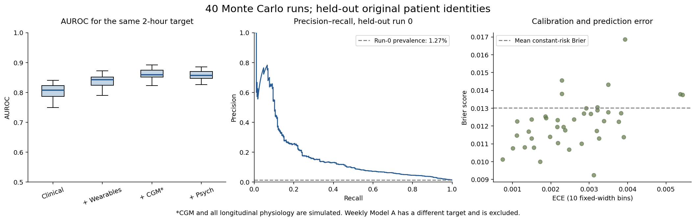
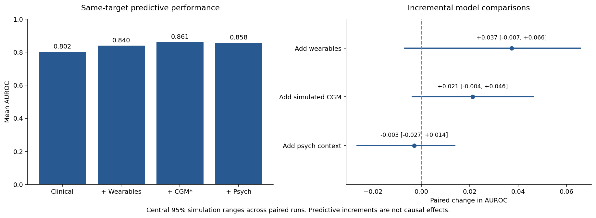
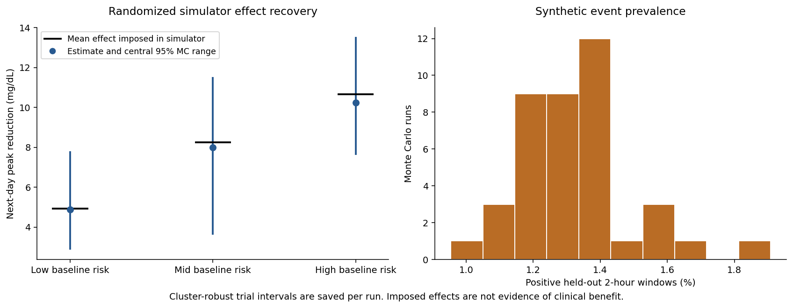
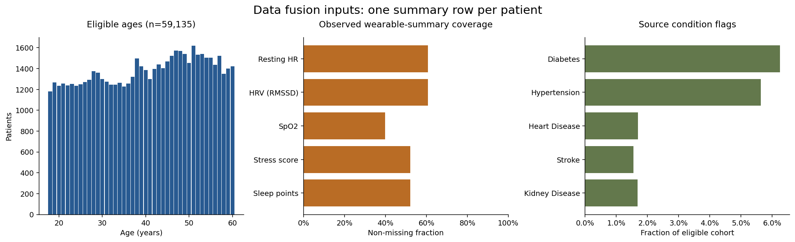
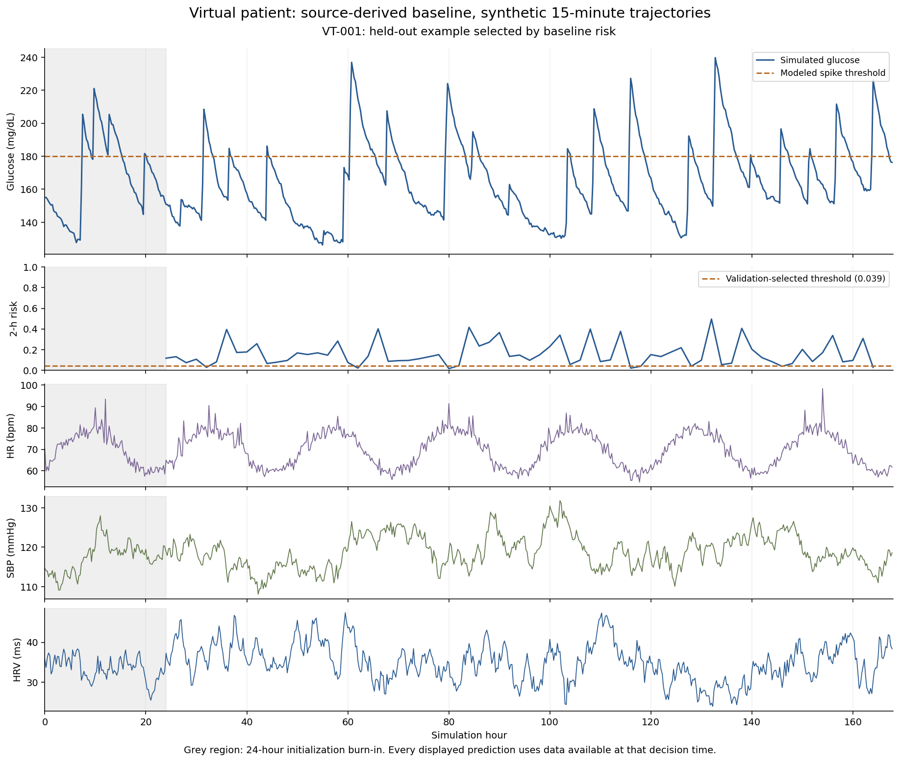

# Completed Monte Carlo outputs

The completed run used **59,135 eligible source patients aged 18–60**, 40 independent seeded simulations, 1,500 bootstrap trajectories per simulation, seven days and 15-minute steps. The prediction target is a **synthetic glucose event in the next two hours** after a 24-hour burn-in.

All bracketed ranges below are central 95% Monte Carlo ranges across runs, not clinical confidence intervals. The CSV contains summary data; **all longitudinal observations and event labels are simulated**. No real-world predictive accuracy or treatment benefit is established.

## Predictive model outputs

| Model, same held-out 2-hour target | AUROC | Average precision | Brier score |
|---|---:|---:|---:|
| Clinical baseline | 0.802 [0.751, 0.836] | 0.080 [0.055, 0.109] | 0.0126 [0.0100, 0.0154] |
| Clinical + wearables / simulated BP | 0.840 [0.801, 0.871] | 0.107 [0.079, 0.149] | 0.0125 [0.0101, 0.0150] |
| Add simulated CGM | 0.861 [0.826, 0.891] | 0.156 [0.094, 0.236] | 0.0121 [0.0100, 0.0148] |
| Add psychological context | 0.858 [0.830, 0.883] | 0.154 [0.101, 0.237] | 0.0122 [0.0100, 0.0146] |

- Test positive-window prevalence: 1.32% [1.05%, 1.66%].
- Constant training-prevalence predictor Brier score: 0.0130 [0.0104, 0.0164]. Lower Brier is better.
- Full-model ECE, ten fixed-width probability bins: 0.0026 [0.0010, 0.0054]. This coarse ECE can be small with rare events and does not alone establish good calibration.
- Two-hour SBP MAE: 2.81 [2.78, 2.84] mmHg.
- Two-hour stress-index MAE: 0.0305 [0.0298, 0.0310] on the 0–1 scale.
- Weekly clinical-only Model A AUROC: 0.802 [0.758, 0.843]. Its target is any modeled weekly glucose decision-window event or the synthetic cardiovascular rule, so it is not ranked against Model B.
- Synthetic cardiovascular rule prevalence: 12.05% [8.96%, 15.95%]. Any modeled weekly event: 46.15% [38.51%, 50.58%].

## Incremental predictive value

| Addition to the preceding model | Paired AUROC change |
|---|---:|
| Wearable summaries and simulated wearable/BP history | 0.037 [-0.007, 0.066] |
| Simulated CGM | 0.021 [-0.004, 0.046] |
| Psychological context and simulated stress | -0.003 [-0.027, 0.014] |

These are paired predictive ablations. A central simulation range spanning zero does not support a consistent gain under the tested generator. Their sum is the mean full-minus-clinical AUROC difference. The simulator is partly constructed from clinical features, so its ablation results are specific to these design assumptions.

## Alert outputs on test patients

| Operating point | Precision | Window recall | Alerts per 100 decision windows |
|---|---:|---:|---:|
| Threshold selected by validation F2 | 12.3% [7.4%, 18.5%] | 39.4% [26.5%, 58.7%] | 4.61 [2.01, 9.41] |
| Original fixed threshold 0.30 | 33.4% [23.8%, 46.5%] | 12.4% [5.5%, 23.2%] | 0.50 [0.22, 0.96] |

The validation-selected threshold is 0.057 [0.033, 0.086]. Thresholds vary by run. Precision is undefined when no alert is emitted; valid-run counts are retained in summary.json. Metric means are means across runs, not pooled patient estimates. Rare-event prevalence is the relevant reference for average precision.

Mean lead among detected eligible threshold crossings: **71.1 [61.8, 81.9] minutes**. Eligible crossing recall: 52.9% [37.5%, 69.1%]. Only alerts strictly before the crossing and at most 120 minutes before it are counted. The maximum counted lead across runs is 120 minutes. These crossing metrics differ from the window-label definition, which also permits a rise of 70 mg/dL.

## Randomized simulator outputs

Daily availability probability is 0.8, and prompt randomization probability is 0.5. The next-day peak benefit is imposed as a risk-dependent 4–12 mg/dL reduction. Treatment-centered regression uses only observed randomized outcomes and prior history. Per-run standard errors account for repeated days within each simulated trajectory.

| Baseline-risk stratum | Estimated reduction (mg/dL), MC range | Mean imposed effect (mg/dL) | Per-run cluster 95% interval coverage |
|---|---:|---:|---:|
| Low | 4.87 [2.91, 7.75] | 4.92 | 95.0% |
| Mid | 7.98 [3.67, 11.47] | 8.24 | 90.0% |
| High | 10.23 [7.66, 13.48] | 10.66 | 95.0% |

This is a recovery check for a known synthetic intervention, not evidence that an activity prompt lowers a person's glucose by these amounts. Coverage estimates are coarse with only 40 runs.

## Data fusion and privacy outputs

Input: 82,767 rows, 32 columns, one source row per unique patient ID. The age rule excludes 23,632 rows outside 18–60 or with unavailable ages. Selected-cohort unique IDs: 59,135. Duplicate IDs: 0.

There are only **43 distinct complete HR/HRV/breathing summary triplets across 35,909 rows**. The most repeated triplet occurs 878 times. Repeated values do not establish the same physical wearer, but prevent treating these rows as verified independent Fitbit participants. Evaluation separates supplied patient IDs; it cannot validate unprovided original wearable-user identities.

Observed, pre-imputation coverage:

| Input summary field | Observed fraction |
|---|---:|
| nremhr | 60.7% |
| rmssd | 60.7% |
| spo2 | 39.9% |
| full_sleep_breathing_rate | 60.7% |
| sleep_points_percentage | 52.1% |
| sleep_hours | 100.0% |
| nightly_temperature | 90.3% |
| TENSE/ANXIOUS | 88.6% |
| TIRED | 88.6% |
| stress_score | 52.1% |
| bad_mental_days | 100.0% |

There are no source timestamps to test real-time alignment, missing intervals or forecast labels. Train-fitted imputation and missingness flags support this prototype, but cannot recover a measured stream. Original linkage and source licensing require documentation before reuse outside this local research setting.

For age, gender, rounded BMI and smoking quasi-identifiers, **6.95% of records are unique**, minimum k is 1, and 20.82% of records lie in classes with k≤3. The fraction of classes with k≤3 is 65.07%, a different denominator. These diagnostics do not certify anonymization. No legal-compliance claim is made. The dashboard excludes source IDs and coarsens example ages; local replay vectors still contain source-derived features.

## Virtual-patient output

Five held-out examples are selected at baseline-risk quantiles independently of future events. Open dashboard.py through Streamlit to choose a patient, replay available history and inspect probabilities. Future trajectories require an explicit retrospective setting.

## Reproducibility and checks

- Original identity overlap across train, validation and test: 0 in every run.
- Completed run rows: 40. Each run uses a distinct recorded seed.
- Aggregated held-out windows: 853,065; this sum includes independent simulated trajectories and is not a count of distinct real people.
- Frozen run-0 model: model_full_run0.npz. Its saved scaling and weights can replay held-out feature vectors with predict.py.
- Input SHA-256, parameters and versions: provenance.json.
- Behavioral tests cover alignment, grouped bootstrap splits, train-only imputation, no-future rolling features, event-horizon boundaries, tied scores, scalar bias learning, confusion counts, model replay, input validation, and trial effect recovery. Check verification.json for the recorded test result and UI checks.

See ../README.md for formulas, limitations, repair details, launch commands, privacy references and interpretation. Results supersede the supplied JSON metrics and five original figures.
