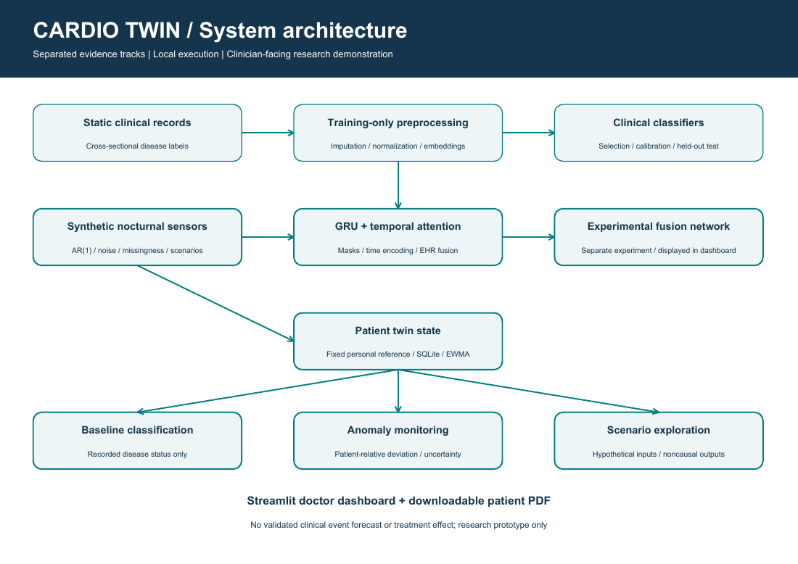
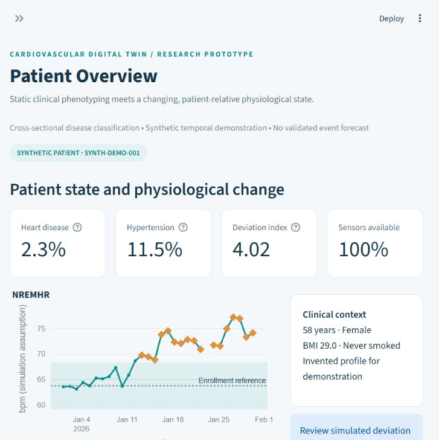

# Cardio Twin

**Recorded cardiovascular disease classification + synthetic physiological monitoring**

Happiest Health Digital Twin Challenge 2026, Bengaluru - research prototype.
Team: **Farmers** Streamlit: **https://digitaltwin-bz6tu66k5vhowzrfwhuk2w.streamlit.app**

This is a runnable Python application with trained artifacts, a seven-page
Streamlit dashboard, patient-specific state updates, intervention input scenarios,
PDF reports, reproducible scripts and automated tests. It does not predict
imminent cardiac events or claim causal treatment effectiveness.

## Launch the bundled demo

Tested: Python 3.12.14, Windows, CPU. Python 3.11 is allowed by
the package metadata but was not tested here. Use Python 3.12 to match execution.
No proprietary API, account, paid service or raw patient data is required for the demo.

Windows PowerShell, from this project directory:

```powershell
py -3.12 -m venv .venv
.\.venv\Scripts\python.exe -m pip install -r requirements.txt
.\.venv\Scripts\python.exe scripts/run_demo.py
.\.venv\Scripts\python.exe -m streamlit run dashboard/app.py
```

Linux/macOS:

```bash
python3.12 -m venv .venv
source .venv/bin/activate
python -m pip install -r requirements.txt
python scripts/run_demo.py
python -m streamlit run dashboard/app.py
```

Open http://127.0.0.1:8501. If LightGBM needs OpenMP on macOS, install the system
OpenMP runtime. Docker installs libgomp1 on Linux:
`docker build -t cardio-twin .` then `docker run --rm -p 8501:8501 cardio-twin`.
Docker, macOS, Linux and CUDA paths are provided but not executed in this build.
For GPU use a compatible official PyTorch installation and `--device cuda`;
the included tested environment uses CPU. `environment.yml` is an alternate
Conda environment. `requirements-lock-windows-py312.txt` records the exact tested
transitive package set; the top-level requirements are portable version pins.

## Dataset and permissions

The local audit processed **82,767 rows and 32 columns**.
The supplied brief said 33 columns; the CSV has 32. Patient IDs are unique,
timestamps are absent and no incident-event label is available.
Targets are `heart_disease` and `hypertension`, both recorded disease status.
Wearable provenance, units, score direction and patient linkage are unverified.
Missingness is high and repeated wearable values suggest aggregation or reuse.

The source CSV is intentionally **not included** because redistribution permission
was not established. Place an authorized copy at `data/raw/FINAL_dataset_with_fitbit.csv`,
or pass `--data PATH` to each data-dependent script. No real patient records appear
in screenshots or demo reports. Review source terms before publishing model weights.

## Executed results

| target | features | model | roc_auc | pr_auc | sensitivity | specificity | precision | f1 | brier |
| --- | --- | --- | --- | --- | --- | --- | --- | --- | --- |
| heart_disease | clinical | random_forest | 0.8893 | 0.2584 | 0.8892 | 0.7499 | 0.1442 | 0.2482 | 0.0372 |
| heart_disease | combined | hist_gradient_boosting | 0.8876 | 0.2617 | 0.8652 | 0.7617 | 0.1469 | 0.2511 | 0.0372 |
| hypertension | clinical | hist_gradient_boosting | 0.7809 | 0.2341 | 0.7657 | 0.6586 | 0.1839 | 0.2966 | 0.0757 |
| hypertension | combined | lightgbm | 0.7806 | 0.2331 | 0.7591 | 0.6668 | 0.1863 | 0.2992 | 0.0757 |

Test set: 16,546 rows. PR-AUC denotes average precision.
All five requested baseline families trained in both feature modes for each target;
the best four calibrated baseline pipelines are saved. Model choice uses tune data,
calibration uses its own partition, and thresholds maximize tune balanced accuracy.
Low positive predictive value means many positive classifications are false
positives at these cutoffs. No operating threshold is clinically validated.

- heart_disease, fixed hist_gradient_boosting: combined-minus-clinical ROC-AUC -0.0017, 95% CI -0.0035 to -0.0002; AP +0.0008, 95% CI -0.0072 to +0.0093.
- hypertension, fixed lightgbm: combined-minus-clinical ROC-AUC -0.0008, 95% CI -0.0017 to -0.0001; AP -0.0018, 95% CI -0.0047 to +0.0005.

Synthetic per-observation anomaly evaluation: **ROC-AUC
0.957, sensitivity 0.853,
specificity 0.962** across 180 simulated
patients. This detects injected perturbations and cannot establish clinical efficacy.
The PyTorch fusion branch executes and is separately labeled as a mixed-source
experiment. Its synthetic sequence result must not be promoted as cardiac prediction.

## Architecture and scientific motivation

Clinical variables are encoded with training-only transformations. The experimental
neural branch combines numerical normalization/categorical embeddings with a
masked GRU, temporal attention and gated fusion. Baseline classifiers and the
patient-relative temporal detector remain separately interpretable.

Stress/autonomic, sleep, metabolic and respiratory mechanisms motivate the project,
but they are untested hypotheses in these data. See
[clinical hypotheses](docs/clinical_hypotheses.md) for primary source references.



[Architecture PDF](docs/architecture.pdf) · [Technical design](docs/architecture.md)

## Dashboard



Pages: Patient Overview; Physiological Monitoring; Cardiovascular Risk Analysis;
Digital Twin Simulation; Intervention Explorer; Research and Model Validation;
Patient Report. Use the sidebar scenario and replay sliders to show baseline
learning, stable measurements and emerging synthetic deviations.
The intervention explorer displays **Hypothetical model scenario - not a validated
treatment recommendation.** Duration is descriptive, not a learned response horizon.

## Reproduce the entire analysis

Activate the environment and supply the authorized CSV before these commands:

```bash
python scripts/audit_dataset.py --data PATH_TO_CSV
python scripts/train_baselines.py --data PATH_TO_CSV
python scripts/generate_synthetic_data.py
python scripts/train_fusion.py --data PATH_TO_CSV
python scripts/evaluate_models.py --data PATH_TO_CSV
python scripts/matched_ablation.py --data PATH_TO_CSV
python scripts/run_demo.py
python -m pytest tests/ -v --junitxml=outputs/metrics/final_tests.xml
python scripts/build_reports.py
python scripts/package_project.py
```

Set `CARDIO_DATA_PATH` to omit `--data`, except the audit CLI takes its own explicit
default path. Random seed is 42. Available flags are described by each script's
`--help`. YAML files document the tested defaults; supported overrides are CLI flags.
Auditing/tuning/evaluation need the original CSV. Inference, dashboard, tests and
the synthetic demonstration use bundled artifacts and run without it.

## Inspectable outputs

- `reports/data_audit.html`: complete schema, completeness and label audit.
- `reports/model_comparison.md`: actual comparisons, CIs, calibration and ablations.
- `reports/clinical_validation.md`: three validation tracks and exact limitations.
- `reports/final_research_report.md`: research narrative and future study requirements.
- `outputs/metrics/`: machine-readable results, bootstrap CIs, subgroup and sensitivity analyses.
- `outputs/patient_reports/synthetic_patient_report.pdf`: invented-patient example.
- `docs/demo_script.md`: detailed 24-minute presentation guide.
- `notebooks/`: EDA, model comparison and twin companions, with executable source cells.
- `docs/model_card.md`, `docs/data_card.md`, `docs/ethics_and_privacy.md`.

Tests are recorded in `outputs/metrics/test_summary.json`; the final delivery also
checks ZIP CRC integrity and clean extraction. The tests cover chronology, invalid
data, state persistence, leakage guards, models, simulation, reporting and all UI pages.
Notebook cells are provided for inspection and reruns, not claimed as executed notebooks.

## Limitations and license

This is not a certified medical device. No real temporal outcomes, independent
external validation, causal interventions or clinically calibrated individual
uncertainty exist. The source sensor linkage and scales remain unknown. Classifiers
identify associations with existing labels. Synthetic detection results reflect the
generator. SQLite and the local UI do not implement secure clinical deployment.
Only trained artifacts you trust should be loaded.

Original software is MIT licensed; source dataset rights and trained-weight
redistribution terms are not verified. See LICENSE and data/raw/README.md.
The package is prepared for review; no public repository has been published.

## Version 0.2 — loneliness and BP research extension

See [enhancement audit](reports/enhancement_audit.md) and [research protocol](docs/research_extension.md).
The dashboard adds **Loneliness and BP Research**. New executable components cover matched psychological/wearable ablation, adjusted associations, measurement availability, BP summaries, five-state filtering, four-modality neural prediction, censored survival and restricted randomized-trial/IPW estimation.

```powershell
python scripts/analyze_psychosocial.py --data "PATH/FINAL_dataset_with_fitbit.csv"
python scripts/run_research_demo.py
python scripts/build_enhancement_report.py
```

All longitudinal and causal demonstrations are explicitly synthetic. No loneliness or BP measurement is manufactured for the original CSV. An unmeasured biological axis remains unsupported, even if the simulator can plot it. The new clinical-context comparison differs from the historical clinical baseline, which included `bad_mental_days`. Both sets of results are retained.
