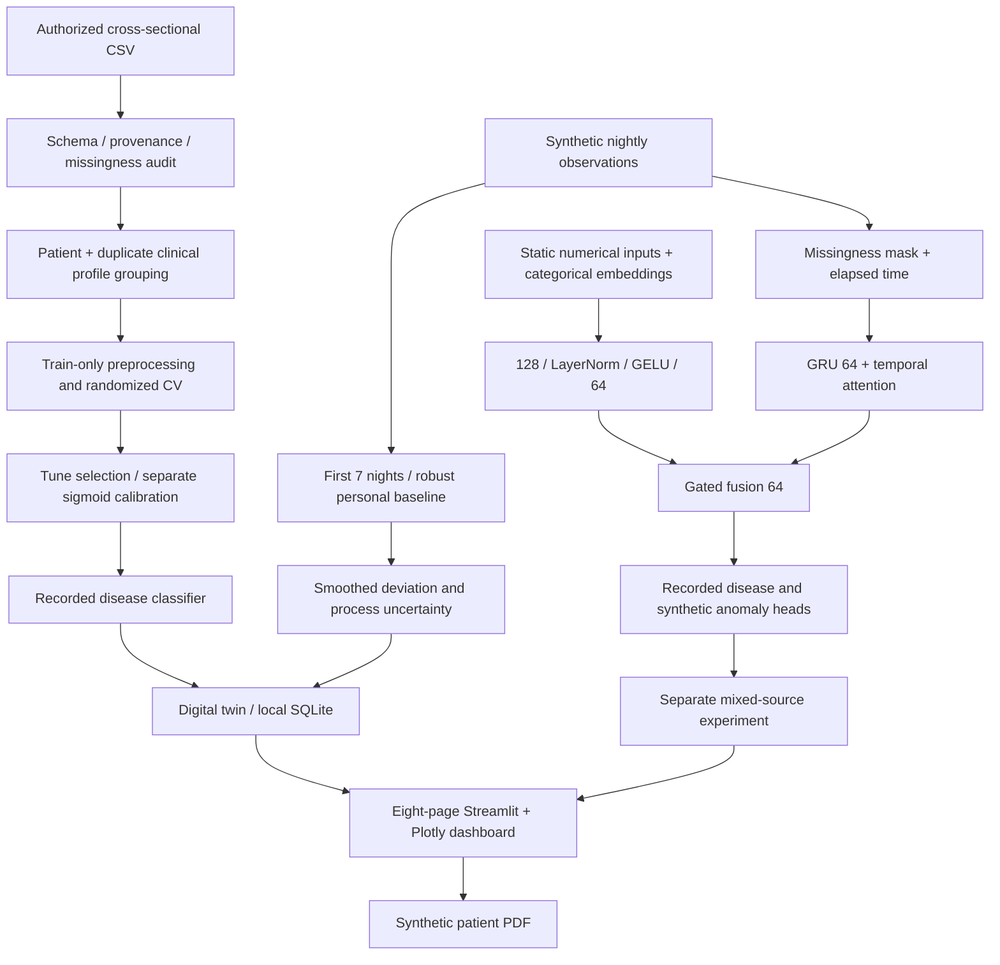
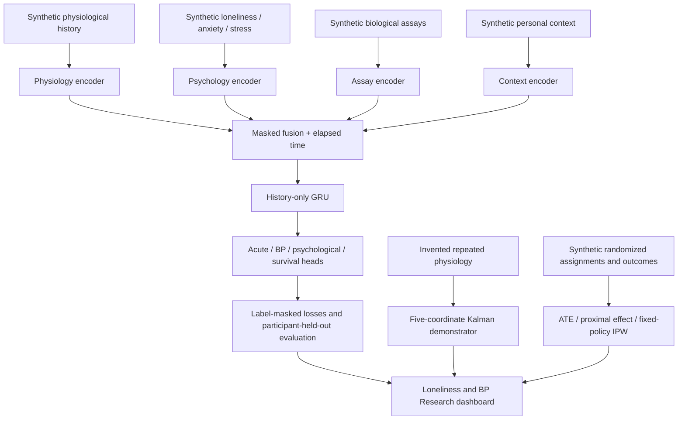

# Architecture and evidence boundaries

See `architecture.pdf` for the presentation diagram.

Baseline classification uses four partitions: approximately 60% training, 10%
tuning, 10% calibration and 20% test. Stratification uses both binary target
labels. Patient IDs and identical clinical predictor profiles are unioned before
assignment. The test partition is not used for selection, calibration or thresholds.

Each target has five model families under two feature sets. Randomized search
uses two candidates and two grouped CV folds in training. Models are selected by
uncalibrated tuning average precision. A sigmoid calibrator is fit separately.
The classification threshold maximizes tuning balanced accuracy after calibration.
This operating point is an engineering illustration with no established clinical utility.

The experimental fusion model uses real EHR/heart-disease labels and independently
generated synthetic sequences, with categorical embeddings, numerical scaling,
GRU, temporal attention, gated fusion and two heads. Its objective sums weighted
binary disease loss and synthetic anomaly loss; AdamW adds regularization.
This historical mixed-source model has no forecasting head.
Version 0.2 adds a separate entirely synthetic longitudinal model with explicit
future BP, acute, psychological and right-censored event heads. It does not
reuse cross-sectional labels as fabricated event times.

The local research twin keeps static classification separate from chronological
physiological state. Its state transition is z[t] = .7 z[t-1] + .3 deviation[t].
Process variance propagates with a chosen .1 noise term and missingness penalty;
this is a transparent heuristic, not a learned physiological uncertainty model.
The first seven nights define a fixed reference, preventing deterioration from
being absorbed into the reference. At least four observations per sensor and
three usable sensor channels are needed for scoring.

Daily nocturnal summaries do not have an intra-day circadian cycle. The simulator
models autocorrelation, noise, missingness, gradual/abrupt shifts and patient
heterogeneity, and explicitly omits continuous heart rate and step count.

The YAML files document tested defaults. Supported runtime overrides are explicit
CLI flags, not a hidden dynamic configuration loader. This keeps reruns inspectable.
SQLite is local, without encryption or access controls; only synthetic demos are
supported in the default UI. Joblib artifacts must be loaded only from trusted sources.

## Version 0.2 research modules

The five-coordinate state filter and trial estimators are separate demonstrations,
not hidden inputs to the clinical classifier. The neural checkpoint can be loaded
and executed from the dashboard. The original enrollment detector starts scoring
on night eight, after a separate seven-night reference. New domain comparisons
reuse the initial held-out partition post hoc and are explicitly exploratory.
See `research_extension.md` for the equations, data requirements and study design.
